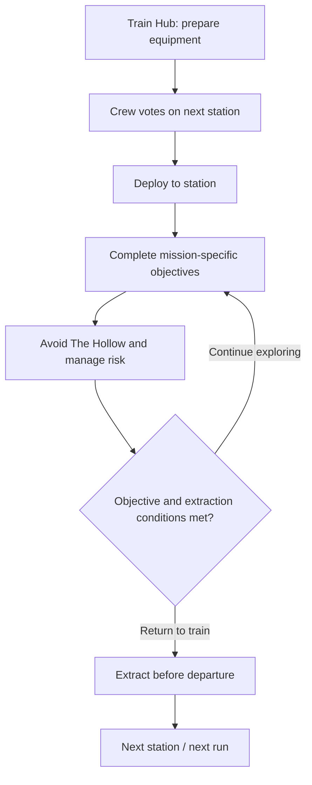

# NIGHTLINE: LAST TRAIN

**Tagline:** Every stop is a risk. Every return is a reward.  
**Version:** 0.3.0 (Priorities 1–4 Complete: Mission-Specific Objectives via `ObjectiveService`, Independent & Cooperative Mission Regression Suite, and Prepared Server Interfaces for The Hollow via `MonsterService`)  
**Target Platform:** Roblox (Luau `--!strict`, Rojo 7.7.1, Native Modular Service/Controller Architecture)

---

## At a glance


**Why it matters:** NIGHTLINE is built around cooperative tension rather than isolated combat: players prepare together, choose a destination, split the mission work, and return to the train before the run collapses.

## Gameplay loop



**Verification:** The repository documents a clean-checkout toolchain and CI checks covering Rojo build, Luau formatting/linting/type analysis, Luau VM tests, Workbench tests, TypeScript type-checking, and the production Vite build. See [reproducible setup and test instructions](#4-reproducible-setup-build-and-test-instructions).

---
## 1. Project Overview

**NIGHTLINE: LAST TRAIN** is a 1–6 player cooperative survival adventure on Roblox. A crew boards the last functioning train traveling through an abandoned transit network, prepares equipment inside the Train Hub, votes on the next station destination, explores dangerous stations to complete objectives while evading **The Hollow**, and extracts before the train departs.

This repository provides:
1. **The Native Luau & Rojo 7.7.1 Project (`/roblox`, `default.project.json`, `selene.toml`, `stylua.toml`, `.luaurc`, `rokit.toml`)**: Verified across all 21 Luau modules with the official `luau` (`0.746`), `luau-analyze` (`0.746`), `luau-lsp` (`1.70.1`), `rojo` (`7.7.1`), `selene` (`0.32.0`), and `stylua` (`2.6.0`) binaries.
2. **Reproducible Toolchain Bootstrap (`scripts/bootstrap-toolchain.sh`), Committed Lockfile (`package-lock.json`), & GitHub Actions CI (`.github/workflows/ci.yml`)**: Runs `npm ci` cleanly from a fresh checkout and installs all pinned Linux `x86_64` binaries (`luau`, `luau-analyze`, `luau-lsp`, `rojo`, `stylua`, `selene`) and official Roblox `globalTypes.d.luau` definitions.
3. **Mission-Specific Objectives & Dedicated `ObjectiveService.lua` (`ObjectiveService.lua`, `ObjectiveConfig.lua`, `InventoryService.lua`, `HubService.lua`)**:
   - **`RestorePower` (`requiredProgress = 3`)**: Locate three individual fuses (`FusePickup_01..03`), pick up and carry them in `InventoryService` (`"Fuse"`), and install them into three designated maintenance sockets (`FuseSocket_01..03`) inside the Maintenance Room.
   - **`RecoverCargo` (`requiredProgress = 2`)**: Locate two sealed cargo containers (`CargoContainer_01..02`) in the Cargo Storage Bay, pick up and carry them (`"CargoContainer"`, 1 carried at a time per player), and deliver them to the platform drop point (`CargoDropPoint_01`).
   - **`RepairSignal` (`requiredProgress = 3`)**: Activate three communication terminals (`SignalTerminal_01..03`) across the Control Room and Main Concourse.
   - **Strict Server Validation & Anti-Abuse**: Rejects interactions unrelated to the active mission (`"MissionMismatch"`), prevents duplicate collection/installation/delivery, enforces server-side distance checks (`<= 14.0` studs) and cooldowns, resets cleanly between rounds, and automatically restores carried uninstalled fuses or undelivered cargo containers back to their Station 001 pickup spots if the carrier is eliminated or disconnects.
4. **Prepared Server-Side Interfaces for The Hollow (`MonsterService.lua`, `MonsterConfig.lua`)**:
   - Implements the complete server-side interfaces for **player detection** (sight range, FOV cone, wall line-of-sight via `HubService`, hiding spot immunity, threat scoring), **noise events** (`Walk`, `Sprint`, `ObjectiveInteraction`, `FlareDistraction`, `DoorTransit`), **monster state management** (`INACTIVE`, `PATROL`, `INVESTIGATE`, `CHASE`, `SEARCH`, `RETURN`), **station navigation** (8-node Station 001 waypoint graph + BFS route solver), **hiding locations** (6 physical lockers `HidingLocker_01..06` with single-occupant enforcement), and **validated player elimination** (`CanEliminateTarget` / `ExecuteValidatedElimination`). Per instructions, the active autonomous monster NPC is not spawned until the objective system is verified.
5. **Physically Playable Station 001 Environment (`HubService.lua`)**:
   - Solid `CanCollide = true` floor slabs (`TrainFloor`, `TrainToStationBridge`, `StationPlatformFloor`, `MainConcourseFloor`, `MaintenanceRoomFloor`, `ControlRoomFloor`, `CargoStorageFloor`) with zero fall-through gaps.
   - Six solid `CanCollide = true`, `Anchored = true` arrival spawn pads (`StationEntrySpawn_01..06` at `X = 15..21, Z = 18..30`), strictly outside `ExtractionPlatformZone` (`X = 16, Z = -8`, radius `10.0` studs).
6. **Real Luau VM & Toolchain Automated Test Suite (`src/engine/luauVmRunner.ts`, `src/engine/nightline.test.ts`)**: Compiles `NIGHTLINE_Last_Train.rbxl` with Rojo 7.7.1, runs `luau-analyze` and `luau-lsp analyze` in `--!strict` mode, runs `selene` and `stylua --check`, and executes the actual `/roblox/**/*.lua` modules inside the official `luau` VM across all 3 missions, `MonsterService` interfaces, and all 10 round lifecycle stages.

---

## 2. Technology Stack

- **Language:** Luau (`--!strict` mode enabled across all 21 modules)
- **Architecture:** Native modular Service (`ServerScriptService/Services`) and Controller (`StarterPlayerScripts/Controllers`) ModuleScripts with explicit `Init()` and `Start()` lifecycles. No Knit, Flamework, Nevermore, or Matter.
- **Workflow:** Rojo `7.7.1` (`default.project.json`, compliant with Roblox's content-property serialization update)
- **Formatting, Linting & Type Checking:** StyLua `2.6.0` (`stylua.toml`), Selene `0.32.0` (`selene.toml`), Luau CLI `0.746`, and Luau Language Server `1.70.1` (`.luaurc` + `globalTypes.d.luau`)
- **Toolchain Management:** Reproducible bootstrap script (`scripts/bootstrap-toolchain.sh`) + Rokit (`rokit.toml`) + GitHub Actions CI (`.github/workflows/ci.yml` + `package-lock.json`)

---

## 3. Repository Structure

```text
/
|-- .github/
|   `-- workflows/
|       `-- ci.yml                # GitHub Actions CI (npm ci, StyLua, Selene, Luau-LSP, Rojo Build, Luau VM Tests)
|-- scripts/
|   `-- bootstrap-toolchain.sh    # Clean-checkout installer for luau, luau-lsp, rojo, stylua, selene & globalTypes.d.luau
|-- package.json                  # Node.js scripts and dependencies
|-- package-lock.json             # Deterministic npm lockfile for npm ci and GitHub Actions cache
|-- default.project.json          # Rojo 7.7.1 project file (no deprecated FilteringEnabled)
|-- .luaurc                       # Luau Language Server strict mode configuration
|-- selene.toml                   # Selene linter rules (std = "roblox")
|-- stylua.toml                   # StyLua code formatting configuration
|-- rokit.toml                    # Pinned CLI versions: rojo 7.7.1, stylua 2.6.0, selene 0.32.0, luau-lsp 1.70.1
|-- roblox/
|   |-- ReplicatedStorage/
|   |   |-- Shared/
|   |   |   |-- Config/
|   |   |   |   |-- GameConfig.lua
|   |   |   |   |-- ItemConfig.lua
|   |   |   |   |-- StationConfig.lua
|   |   |   |   |-- ObjectiveConfig.lua
|   |   |   |   |-- MonsterConfig.lua
|   |   |   |   `-- RewardConfig.lua
|   |   |   |-- Types/
|   |   |   |   `-- NetworkTypes.lua
|   |   |   `-- Utils/
|   |   |       |-- Signal.lua
|   |   |       `-- Janitor.lua
|   |   `-- Remotes/
|   |       `-- RemotesRegistry.lua
|   |-- ServerScriptService/
|   |   |-- Bootstrap.server.lua
|   |   `-- Services/
|   |       |-- SecurityService.lua
|   |       |-- MovementService.lua
|   |       |-- HubService.lua
|   |       |-- InventoryService.lua
|   |       |-- ObjectiveService.lua
|   |       |-- MonsterService.lua
|   |       |-- RoundService.lua
|   |       `-- InteractionService.lua
|   `-- StarterPlayer/
|       `-- StarterPlayerScripts/
|           |-- ClientBootstrap.client.lua
|           `-- Controllers/
|               |-- UIController.lua
|               |-- InputController.lua
|               `-- InteractionController.lua
|-- docs/
|   |-- ARCHITECTURE.md
|   |-- DEVELOPMENT_PROGRESS.md
|   |-- TESTING.md
|   `-- KNOWN_ISSUES.md
`-- src/                          # Luau VM Test Runner + Interactive Train Hub Workbench
```

---

## 4. Reproducible Setup, Build, and Test Instructions

### 4.1 Reproducible Clean-Checkout Verification (Linux / CI)

From a fresh clone of the repository:

```bash
# 1. Clean-install deterministic npm dependencies from package-lock.json
npm ci

# 2. Bootstrap Luau CLI (0.746), Luau-LSP (1.70.1), Roblox globalTypes.d.luau, Rojo (7.7.1), StyLua (2.6.0), and Selene (0.32.0)
npm run bootstrap:toolchain

# 3. Run the full automated test suite (Rojo build, StyLua, Selene, Luau-LSP --!strict, Luau VM runtime tests, and Workbench tests)
npm test

# 4. Run TypeScript typecheck and production Vite build
npm run lint
npm run build
```

### 4.2 Using Rojo 7.7.1 with Desktop Roblox Studio

1. Build a standalone Roblox place file (`.rbxl`):
   ```bash
   rojo build default.project.json -o NIGHTLINE_Last_Train.rbxl
   ```
2. Or start live sync into an open Roblox Studio session with the Rojo 7.7.1 plugin installed:
   ```bash
   rojo serve default.project.json
   ```

### 4.3 Manual Roblox Creator Dashboard & Studio Settings Required

When opening `NIGHTLINE_Last_Train.rbxl` in desktop Roblox Studio for multiplayer testing:
1. **Max Players per Server:** Set Place Settings -> Access -> **Maximum Visitor Count = 6**.
2. **Studio API Access (prepared for Milestone 4):** Enable Game Settings -> Security -> **Enable Studio Access to API Services**.
3. **Multiplayer Local Server Test (Manual Step):** In Roblox Studio -> **Test** tab -> select **Local Server** with **2–6 Players** and click **Start** to verify live 3D character physics, Station 001 concourse navigation, `RestorePower`/`RecoverCargo`/`RepairSignal` interactions, hiding lockers, `Humanoid.Died` -> `CharacterAdded` respawning, sprint replication, and physical extraction zone boarding. *(Note: Six-player desktop Roblox Studio multiplayer testing has not been performed inside this headless Linux environment.)*
